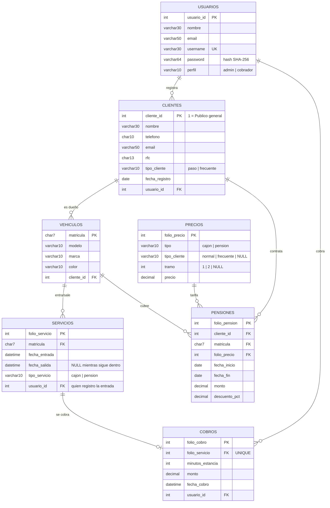

# Modelo de datos: Estacionamiento Público

Borrador para revisar en equipo antes del script SQL. Basado en el PDF del profesor, las mejoras de `Definicion_Proyecto_Estacionamiento.pdf` y las decisiones del chat del 2026-11-06.

## Decisiones que afectan el modelo

| Tema | Decisión |
|---|---|
| Fracciones de hora | Proporcional: se cobra por minuto |
| Cliente frecuente | Automático al llegar a N visitas (N por definir) |
| Clientes de paso | Cliente genérico `cliente_id = 1` "Público general" |
| Contraseñas | Hash SHA-256 (opcional: con sal) |
| Pensión | **Pendiente** (propuesta: mensual con fechas) |

## Diagrama ER



## Cambios respecto al PDF del profesor

- **Servicios:** `fecha_entrada`/`hora_entrada` y `fecha_salida`/`hora_salida` se unen en dos DATETIME. Se quita `folio_precio`, porque con tarifa escalonada una estancia usa dos precios; el precio se calcula al cobrar. Se agrega `usuario_id` (cobrador que registró la entrada). **Hay que confirmarlo con el equipo.**
- **Cobros:** se quita `matricula` (ya está en Servicios). `hora_estancia` pasa a `minutos_estancia` (INT, por el cobro proporcional). Se agregan `monto` y `fecha_cobro`.
- **Clientes:** se agregan `tipo_cliente` y `fecha_registro`.
- **Precios:** se agregan `tipo_cliente` y `tramo`. Cada fila es una tarifa de cajón o la pensión.
- **Pensiones:** tabla nueva.
- **Usuarios:** `password` pasa a VARCHAR(64).

## Datos iniciales (semilla)

**Precios**

| tipo | tipo_cliente | tramo | precio |
|---|---|---|---|
| cajon | normal | 1 (primeras 5 h) | 30.00 |
| cajon | normal | 2 (de la 6ª en adelante) | 25.00 |
| cajon | frecuente | 1 | 26.00 |
| cajon | frecuente | 2 | 22.00 |
| pension | NULL | NULL | por definir |

**Clientes:** `cliente_id = 1`, "Público general", `tipo_cliente = 'paso'`.
**Usuarios:** al menos un admin y un cobrador de prueba.

## Regla de cobro (cajón)

```
minutos   = fecha_salida - fecha_entrada (en minutos)
horas     = minutos / 60
tarifa    = frecuente si el cliente es frecuente, normal si no
monto     = min(horas, 5) * precio_tramo1 + max(horas - 5, 0) * precio_tramo2
            (redondeado a 2 decimales)
```

Ejemplos: 7 h normal = $200.00, 7 h frecuente = $174.00, 7.5 h normal = $212.50.
Si el vehículo tiene una pensión vigente (fecha dentro de `fecha_inicio`–`fecha_fin`), no se cobra por hora.

## Reglas de integridad

- El cliente 1 (Público general) no puede tener pensión ni volverse frecuente.
- Un vehículo no puede tener dos servicios abiertos (sin `fecha_salida`) a la vez.
- `fecha_salida` debe ser mayor que `fecha_entrada`.
- Un servicio se cobra una sola vez (`folio_servicio` UNIQUE en Cobros).
- El perfil cobrador solo registra entradas, salidas y datos del cliente. El admin accede a todo.
- Trigger: al registrar la salida, si el cliente acumula N visitas en el periodo, pasa a `frecuente`.

## Vistas para los reportes

| Requisito | Vista |
|---|---|
| 7. Entradas y salidas por mes | `v_movimientos_mes` (año, mes, entradas, salidas) |
| 8. Meses con mayor demanda por año | `v_demanda_mes` (año, mes, total, ordenado desc) |
| 9. Horarios con mayor demanda por año | `v_demanda_hora` (año, hora, total, ordenado desc) |
| 10. Ingresos por servicio por año | `v_ingresos_anio` (año, tipo_servicio, suma de monto) |

Los ingresos de pensión salen de `Pensiones.monto`. Los de cajón salen de `Cobros.monto`.

## Pendientes que bloquean el SQL

1. Pensión: modalidad, precio y % de descuento después de 2 años.
2. N de visitas y periodo para volverse frecuente.
3. Qué significa "por cada 5 horas" para frecuentes (pregunta al profesor).
4. ¿Sal en las contraseñas? (columna `salt` extra o SHA-256 simple).
