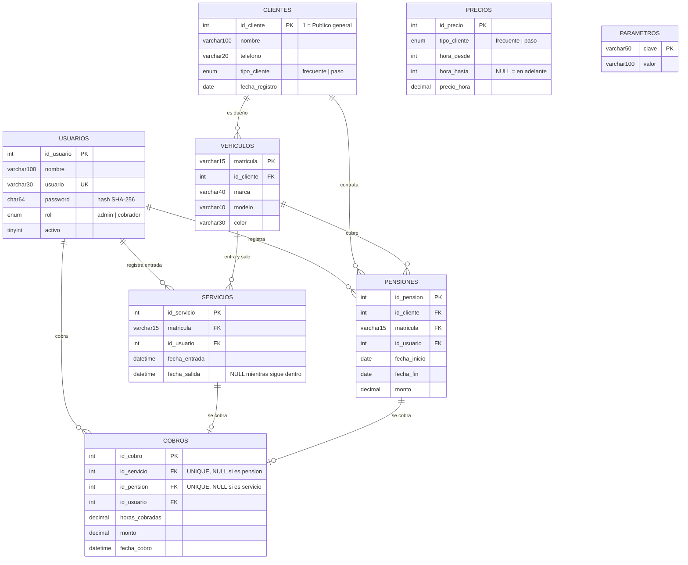

# Modelo de datos: Estacionamiento Público

Modelo final de la base de datos `estacionamiento` (MariaDB). Refleja los scripts de [database/](../database/): `01_tablas.sql` crea las tablas y los datos base, y `02_datos_prueba.sql` carga datos de ejemplo.

## Decisiones que afectan el modelo

| Tema | Decisión |
|---|---|
| Fracciones de hora | Proporcional: se cobra por minuto |
| Cliente frecuente | Automático al llegar a 10 visitas en 30 días (valores en la tabla `parametros`) |
| Clientes de paso | Cliente genérico `id_cliente = 1` "Público general" |
| Contraseñas | Hash SHA-256 en hexadecimal (64 caracteres) |
| Pensión | Por fecha y vehículo. Precio y % de descuento por definir |

## Diagrama ER



`PRECIOS` y `PARAMETROS` no se relacionan con otras tablas con llave foránea: se consultan al calcular el cobro y al decidir si un cliente es frecuente.

## Tablas

| Tabla | Para qué sirve | Notas |
|---|---|---|
| `usuarios` | Quienes entran al sistema | `usuario` es único. `activo` permite dar de baja sin borrar. |
| `clientes` | Clientes registrados | El 1 es "Público general" y es de paso. |
| `vehiculos` | Vehículos de cada cliente | La matrícula es la llave. Un vehículo nuevo se liga al cliente 1. |
| `servicios` | Cada entrada y salida | Con `fecha_salida` en NULL el vehículo sigue dentro. |
| `pensiones` | Contrato por periodo para un vehículo | Con una pensión vigente no se cobra por hora. |
| `cobros` | Pago de un servicio por hora **o** de una pensión | Un servicio o una pensión tiene a lo más un cobro. |
| `precios` | Tarifa escalonada por tipo de cliente | Ver la tabla de abajo. |
| `parametros` | Valores configurables (clave y valor) | `visitas_para_frecuente` y `periodo_dias_frecuente`. |

## Datos base (los crea `01_tablas.sql`)

**Precios**

| tipo_cliente | hora_desde | hora_hasta | precio_hora |
|---|---|---|---|
| paso | 1 | 5 | 30.00 |
| paso | 6 | NULL | 25.00 |
| frecuente | 1 | 5 | 26.00 |
| frecuente | 6 | NULL | 22.00 |

**Clientes:** `id_cliente = 1`, "Público general", de paso.
**Parámetros:** `visitas_para_frecuente = 10`, `periodo_dias_frecuente = 30`.

## Datos de prueba (`02_datos_prueba.sql`)

- **Usuarios:** `admin` / `admin123` y `cobrador` / `cobrador123`.
- 3 clientes (Público general, Ana López frecuente y Luis Pérez de paso), 6 vehículos.
- 26 servicios cerrados entre noviembre de 2025 y octubre de 2026, con su cobro, y 1 servicio que sigue dentro.
- 1 pensión de prueba (octubre de 2026, $1,200.00, valor provisional) con su cobro.

## Regla de cobro (por hora)

```
horas   = (fecha_salida - fecha_entrada) en minutos / 60
tarifa  = precios de 'frecuente' si el cliente es frecuente, de 'paso' si no
monto   = min(horas, 5) * precio_tramo1 + max(horas - 5, 0) * precio_tramo2
          (redondeado a 2 decimales)
```

Ejemplos: 7 h de paso = $200.00, 7 h frecuente = $174.00, 7.5 h de paso = $212.50.
Si el vehículo tiene una pensión vigente (la fecha cae entre `fecha_inicio` y `fecha_fin`), no se cobra por hora.

## Reglas de integridad que ya aplica la base

- La llave foránea impide borrar un cliente, vehículo o usuario que tenga servicios, cobros o pensiones (`ON DELETE RESTRICT`).
- `fecha_salida` no puede ser anterior a `fecha_entrada`.
- `fecha_fin` de una pensión no puede ser anterior a `fecha_inicio`.
- Los montos no pueden ser negativos.
- Un cobro es de un servicio **o** de una pensión, nunca de los dos.
- Un servicio o una pensión se cobra una sola vez.

## Pendiente de implementar

- Función de cobro (issue #6) y vistas de los reportes 7 a 10 (issue #7).
- Trigger para que un cliente pase a frecuente al cumplir las visitas, y validar que un vehículo no tenga dos entradas abiertas (issue #11).

## Reportes y de dónde salen

| Requisito | Fuente |
|---|---|
| 7. Entradas y salidas por mes | `servicios` (agrupado por mes de `fecha_entrada` y `fecha_salida`) |
| 8. Meses con mayor demanda por año | `servicios` (conteo por año y mes) |
| 9. Horarios con mayor demanda por año | `servicios` (conteo por año y hora de entrada) |
| 10. Ingresos por servicio por año | `cobros` (suma de `monto` por año, separando cobros de servicio y de pensión) |

## Pendientes de decisión

1. Pensión: modalidad, precio y % de descuento después de 2 años (hoy el precio de prueba es $1,200.00).
2. Qué significa "por cada 5 horas" para clientes frecuentes (pregunta al profesor).
